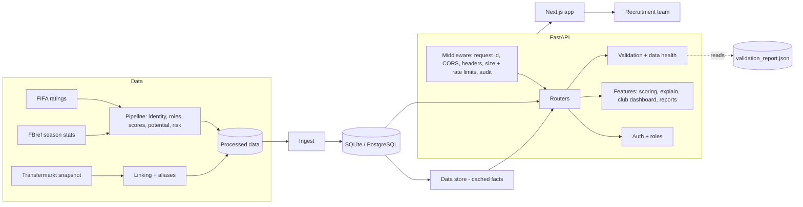

# Architecture Report

## Phase 0 audit findings (original project)

- ~1,160 lines of Python: pandas ETL -> single CSV -> FastAPI -> Streamlit.
- Dataset: 28,436 rows x 135 columns, FIFA + FBref merged, 8 seasons
  (17/18-24/25), ~11,235 unique player names.
- **No stable player ID.** All lookups used case-insensitive substring
  search on `short_name`. 432 `(name, season)` collisions existed
  unresolved.
- **135 columns available, ~13 used.** Role fit, scoring, and valuation
  used only FIFA attribute columns (pace/shooting/passing/etc.) and never
  touched the FBref per-90 stats (progressive passes, xG/xA, tackles,
  SCA/GCA) that are what actually differentiate a role.
- Dead code: `_resolve_role_columns` in the original `role_fit.py` filtered
  against an empty `pd.Index([])` and always returned nothing; unused
  elsewhere, so harmless but wrong.
- Every API endpoint re-read the full CSV from disk per request. No DB, no
  cache, no pagination.
- Scoring and valuation were hand-picked linear formulas
  (`overall*0.45 + potential*0.25 + ...`, `overall*150000 + ...`) with no
  evaluation, no position-awareness, no explanation.

## What was kept

- The column-normalization approach in `clean_dataset.py` (traceable
  mapping file) -- solid, kept as the first pipeline stage.
- FastAPI + `features/` vs `models/` vs `api/` module boundaries -- the
  shape was reasonable, the contents inside were replaced.
- The dataset itself, unchanged as a source.

## What was replaced, and why

| Area | Before | After |
|---|---|---|
| Player identity | Name substring match | Deterministic ID from (name, nationality, birth year); 432 collisions -> 43 genuine edge cases |
| Position | Raw `player_positions` string | Canonical taxonomy, cross-validated against FBref's broad bucket, versatility score |
| Role fit | Sum of 4-5 FIFA attributes / 100 | 18 archetypes, weighted against percentile-normalized per-90 stats, explainable strengths/limitations |
| Scoring | One linear formula, position-agnostic | 7 component scores (attacking/passing/progression/defending/etc.), position-specific weights |
| Potential | FIFA `potential` used as-is | Kept as a labeled benchmark only; real season-over-season trend used where available |
| Valuation | Fabricated linear formula | Trained HistGradientBoostingRegressor, evaluated (MAE/RMSE/R^2/MAPE), permutation feature importance -- see MODEL_CARD.md for its real limitation |
| Risk | Not modeled | Age/availability/league-transition/data-reliability, reported separately, never blended into the performance score |
| Similarity | Single cosine score, sometimes cross-position | 4 separate facets (statistical/tactical/physical/market), position-restricted by default |
| Squad building | Sort by score, take top N | Real ILP (PuLP): exact position-slot constraints + budget constraint, solved to optimality |
| Data layer | CSV read per request | SQLAlchemy + SQLite (Postgres-ready via `DATABASE_URL`), in-memory serving cache with explicit invalidation |
| Frontend | Streamlit prototype | Next.js/TypeScript/Tailwind, dark analyst-tool design system |

## Architecture decision: one wide fact table, not 15 normalized tables

The spec's data-model section lists 15+ tables
(`player_passing`, `player_shooting`, `player_defending`, ...). This was
deliberately NOT implemented as literal 1:1 tables. Nearly every real query
here (percentiles, role fit, scoring) reads across passing + shooting +
defending + progression simultaneously -- splitting them would mean 15
joins on every request for no query-planning benefit on a dataset this
size. Instead: `player_season_facts` is a single wide analytics table
(the standard "fact table" pattern from analytics engineering), populated
directly from the processed DataFrame. What IS modeled as real relational,
ORM-backed tables is the genuinely transactional state: player identity,
shortlists, squad composition, scout notes -- see `src/db/models.py` for
the reasoning inline.

## Known limitations carried forward

- `value_eur` in this dataset is FIFA's in-game valuation, not real
  transfer fees. The valuation model is honest about this
  (`docs/MODEL_CARD.md`) rather than presenting it as true market value.
- League-strength adjustment (spec section 29) is not implemented --
  percentiles are computed within (position, season) peer groups but do
  not currently correct for cross-league quality differences.
- No injury data exists in this dataset and none was fabricated (per the
  spec's own instruction); availability risk is proxied from minutes
  played only.
- `src/config/settings.py` (original, untouched) defines `RAW_DATA_FILE`
  as `data/raw/fifa_fbref_merged.csv`, but the actual source file lives at
  `data/cleaned/fifa_fbref_merged.csv` -- a pre-existing inconsistency from
  the original project. `run_pipeline_v2` is called with explicit paths
  (see README quick start) rather than relying on these defaults, so it
  isn't a functional bug, but the settings constants themselves are stale
  and would mislead anyone reading them in isolation.

## Current system overview

**Request path:** browser -> Next.js -> `Authorization` token -> middleware (limits, headers) -> role check (`authorize`) -> handler -> audit row for any state change.
**Where truth lives:** player facts in the database table loaded by the data store; workflow data (shortlists, entries, events, notes, users, audit log) in the database via Alembic-managed tables; club profiles in `data/club_profile.json`; validation results in `data/validation/validation_report.json` (regenerate with `python -m src.validation.report`).
